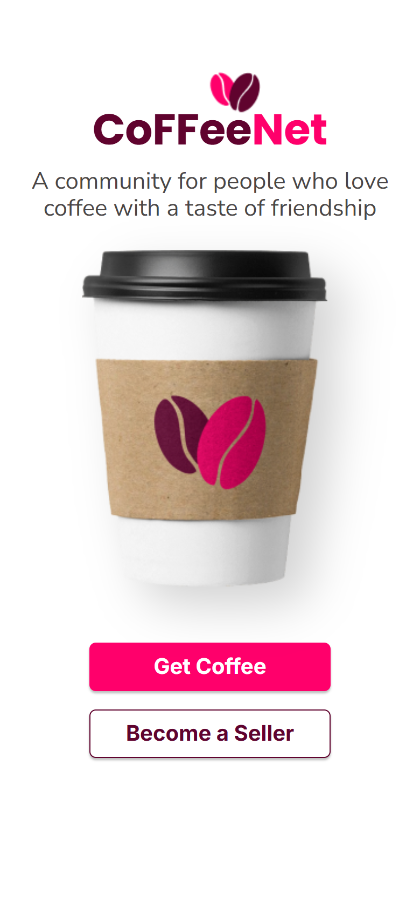
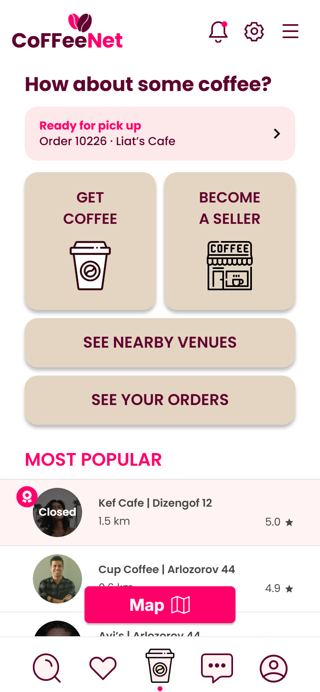
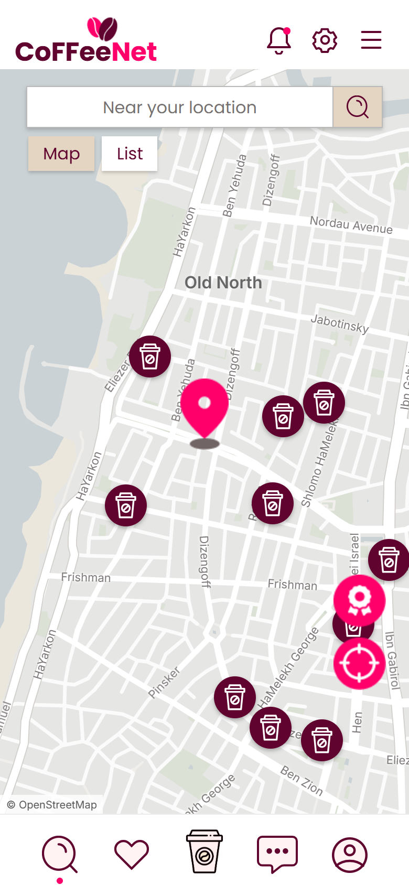

# CoFFeeNet

**A peer-to-peer coffee marketplace for Tel Aviv.** Anyone who can make a good cup of coffee, with a fancy machine, a moka pot or just a kettle, can open a small "shop" from home. Coffee lovers nearby find it on a map, order, pay and pick it up, for a fraction of café prices.

Researched, designed and built end to end by **Liat Inbar Reis**: from user research and Figma design to a working app, built with AI coding tools.

**▶ Try it:** https://inbarliat4-stack.github.io/coffeenet/ (on a phone, or a narrow browser window). Tap **Try the demo account** to skip sign-up.

  
  
  

> This is a portfolio prototype. Other people, seller replies and payments are simulated, and everything you enter stays in your own browser. Please don't enter a real card.

## From research to product

| Step | What I did |
|---|---|
| Research | Survey, user interviews, persona, user journey and a Kano analysis to decide which features matter most |
| Design | User flows and the full UI in Figma, then usability tests |
| Build | Turned the Figma screens into this working app with AI coding tools (Claude Code), including a real street map and both user sides |

## What works

**As a buyer:** join, find sellers on the map (walking, driving or bus route and arrival time), customise a drink, order, wait for the seller to confirm, pay with a PIN, track the order, pick it up and leave a review. Cancel, reorder and receipts work too.

**As a seller:** open a shop on a real street, receive orders, confirm and fulfil them, earn credit and reviews, edit the menu or close the shop.

**Also:** one account for both sides, inbox with notifications and messages, favourites, payment methods, and it installs on a phone and works offline.

## How it's built

No framework and no build step: plain HTML, CSS and JavaScript, so it runs from any static host.

| File | Role |
|---|---|
| `index.html` | The app shell |
| `app.js` | The whole app: a small hash router (`#/home`, `#/map`, `#/order/…`) where each screen is a render function in `R`, plus the simulated "other side" (seller replies, order status) |
| `styles.css` | Design tokens and screen styles, matching the Figma design |
| `map.js` | The map engine: draws Tel Aviv from local street data and calculates routes on it, so the map also works offline |
| `assets/tlv-map.js` | Tel Aviv street data, pre-built from OpenStreetMap |
| `sw.js` | Service worker for offline use and installing on a phone |

Data is saved in the browser (`localStorage`), with a separate store per account.

## Run it locally

Serve the folder with any static server, for example `npx serve .`, then open it in a phone-sized window.

## Credits

Street data © [OpenStreetMap](https://www.openstreetmap.org/copyright) contributors, available under the ODbL. Map display by [Leaflet](https://leafletjs.com) (BSD-2-Clause, see `vendor/leaflet-LICENSE.txt`).
